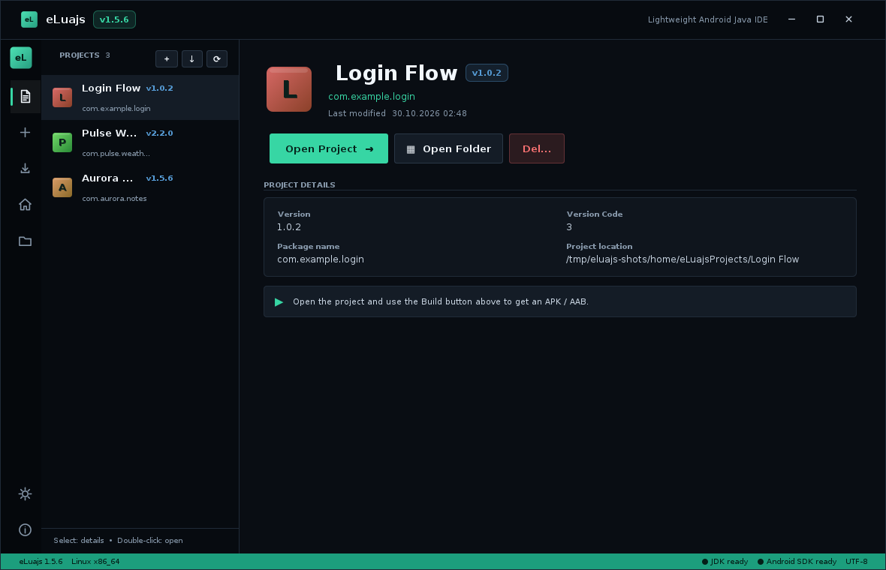
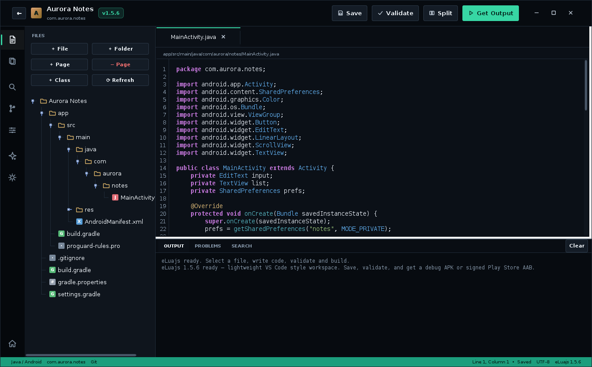
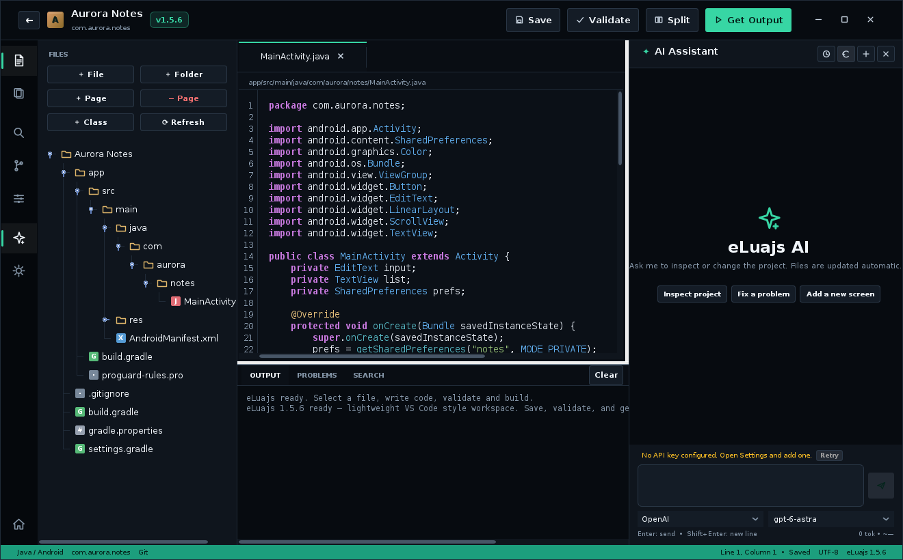
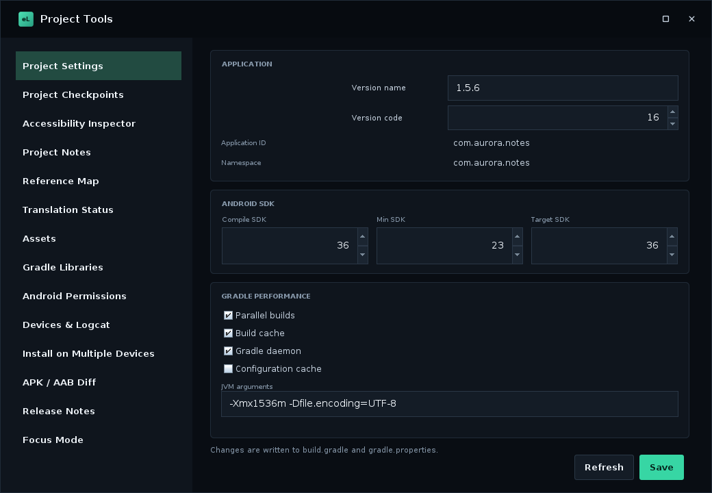
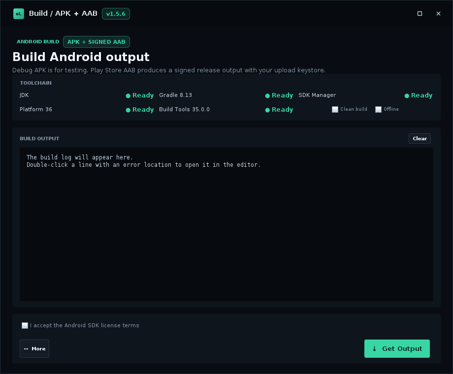
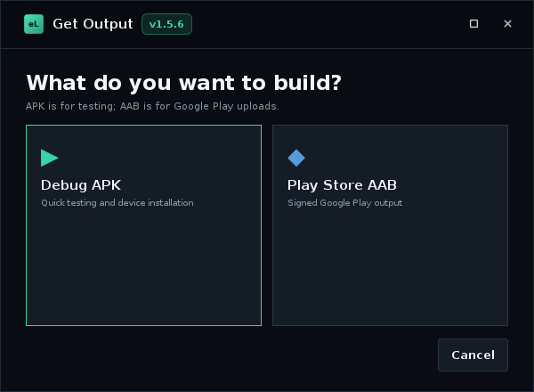

<p align="center">
  
</p>

<h1 align="center">eLuajs</h1>

<p align="center">
  <b>A lightweight Android Java IDE for Linux and Windows.</b><br>
  Create real Android Gradle projects, write Java + XML, validate, and export a debug APK or a signed Play Store AAB.
</p>

<p align="center">
  <a href="https://github.com/whyefkan/eLuajs/releases/latest"></a>
  
  
  
  
  <a href="https://github.com/whyefkan/eLuajs/stargazers"></a>
</p>

<p align="center">
  <a href="https://github.com/whyefkan/eLuajs/releases/latest/download/eLuajs-windows-x86_64.exe"><b>Download for Windows</b></a>
  &nbsp;•&nbsp;
  <a href="https://github.com/whyefkan/eLuajs/releases/latest/download/eLuajs-linux-x86_64.run"><b>Download for Linux</b></a>
  &nbsp;•&nbsp;
  <a href="https://github.com/whyefkan/eLuajs/releases/latest/download/eLuajs-linux-x86_64.zip">Portable Linux zip</a>
  &nbsp;•&nbsp;
  <a href="https://github.com/whyefkan/eLuajs/releases/latest/download/eLuajs.jar">Jar</a>
</p>

---

## Why eLuajs?

- **Actually lightweight** — no Electron, no bundled browser. A compact Java/Swing IDE with a small memory footprint.
- **Real Android projects** — standard Gradle structure, Java + AndroidX, `AndroidManifest.xml`, resources and build outputs.
- **APK and Play Store AAB** — validate, build a debug APK, or sign a release AAB with your upload keystore.
- **Agentic AI assistant** — reads the project, edits files directly, reloads the editor, reports what changed and can undo the last edit.
- **Persistent project chats** — previous conversations are saved per project and restored when you reopen the panel.
- **Runs on Linux and Windows** — portable packages include their own Java runtime; no system Java required.

## Download

All links below always point to the **latest release**.

### Windows
- **Installer:** [`eLuajs-windows-x86_64.exe`](https://github.com/whyefkan/eLuajs/releases/latest/download/eLuajs-windows-x86_64.exe)
- Run the installer, then launch eLuajs from the desktop or Start Menu. Per-user install, no admin or Java required.

### Linux
- **Installer:** [`eLuajs-linux-x86_64.run`](https://github.com/whyefkan/eLuajs/releases/latest/download/eLuajs-linux-x86_64.run)

  ```bash
  chmod +x eLuajs-linux-x86_64.run
  ./eLuajs-linux-x86_64.run
  ```

  Installs to `~/.local/share/eLuajs` and creates desktop/application-menu shortcuts.
- **Portable:** [`eLuajs-linux-x86_64.zip`](https://github.com/whyefkan/eLuajs/releases/latest/download/eLuajs-linux-x86_64.zip) — extract and run `./eLuajs`.

### Jar only
- [`eLuajs.jar`](https://github.com/whyefkan/eLuajs/releases/latest/download/eLuajs.jar) — for users who already have Java 17+.

> The automatically generated “Source code” zips on the release page are not the application. Use the files above or the **Assets** section.

## Screenshots

| Hub | Editor |
| --- | --- |
|  |  |

<p align="center">
  
</p>

<p align="center">
  
</p>

<p align="center">
  
</p>

<p align="center">
  
</p>

## Features

- **VS Code-style shell** — activity bar, explorer sidebar, multi-file tabs, split view, output/problems/search panel, custom window controls, dark, light and pure-black themes with theme-aware scrollbars.
- **Editor built for coding** — syntax highlighting, line numbers, undo/redo (`Ctrl+Z` / `Ctrl+Y`), auto-indent, bracket matching, editor find/replace, zoom, block folding, `Ctrl+Space` completion, `Ctrl+Shift+F` project search and automatic imports.
- **Project tools** — import existing Android projects, starter templates, file/folder/layout operations, new activities, Java classes, assets, Gradle libraries, permissions and AndroidManifest editing.
- **Project settings** — compile/min/target SDK, versionCode/versionName and Gradle performance options.
- **One-click output** — debug APK or signed Play Store AAB, artifact manager, ADB install, versionCode increment, with build logs and click-to-open error locations.
- **Git integration** — status, diff, stage, commit, pull/push, branches and checkout.
- **AI providers** — latest OpenAI GPT-6 family, Claude Fable/Opus/Sonnet/Haiku 5.x, Gemini 4/3.x, Groq, DeepSeek, OpenRouter, local Ollama, River AI and any OpenAI-compatible endpoint.
- **AI 2.0** — diff approval, one-click build fix, local Ollama and optional token budget.
- **Six languages** — English, Turkish, German, French, Spanish and Russian.
- **Reliability** — crash log, stable-only auto-update and recovery copies for file edits.
- **Keyboard-friendly** — `Ctrl+S` save, `Ctrl+Z` undo, `Ctrl+Y` redo, `Ctrl+Shift+F` search, `Ctrl+Shift+N` new class, `Ctrl+Alt+A` AI panel, `Ctrl+\` split view, `Ctrl+Space` completion, **Enter** send chat, **Shift+Enter** new line.

## Quick start

1. Download the Windows installer or the Linux `.run`/zip above.
2. Launch eLuajs.
3. Click **New Project** and set the app name, package and version.
4. Write Java/XML in the editor, then press **Validate**.
5. Open **Build / APK + AAB** to get a debug APK or a signed Play Store AAB.

## AI assistant

Open the docked panel with the activity bar icon or `Ctrl+Alt+A`.

- Choose provider and model from the dropdowns below the composer.
- API keys are stored locally in `~/.eluajs/ai.properties` with `600` permissions.
- The assistant receives the project file tree and requests only the files it needs (`READ:`), keeping token use economical.
- It proposes `WRITE:`/`DELETE:` changes, shows a diff for approval, then reloads the open editor and reports what changed instead of dumping code into the chat.
- If a provider returns a code block without a write command, the app applies it to the open file for change requests.
- **Undo AI edits** restores the last AI modification.
- Conversations are saved under `~/.eluajs/ai-chats` and restored per project. The history button lists previous chats.
- Token usage and approximate cost are shown below the composer. The token budget is optional and off by default; local Ollama needs no API key.

## Versioning

- `1.5.0` was the large feature update (import, tabs, Git, build manager, six languages, and more).
- `1.5.1` was the reliability/security patch.
- `1.5.2` kept both APK and AAB actions visible in the build window.
- `1.5.3` simplified output selection into a single **Çıktı Al** action.
- `1.5.4` added the custom output chooser window and made AI continue after file-reading replies.
- `1.5.5` was the reliability pack: autosave/session restore, project watcher, build cancel/clean/offline/retry, quick open, command palette, line operations, ADB logcat, AI stop/retry/audit and project rules.
- `1.5.6` adds the redesigned project tools hub with inline settings, checkpoints, accessibility, notes, references, translations, assets, Gradle libraries, permissions, APK diff, release notes and focus mode, plus English/Turkish UI fixes.
- Small fixes keep the same minor line: `1.5.2`, `1.5.3`, and so on.
- The minor version (`1.5` → `1.6`) changes only for another large feature set.
- There is no beta channel; every published GitHub release is stable.

## Updates

- Updates always come from the official repository: **`whyefkan/eLuajs`**.
- Auto-check runs on startup and can be disabled in **Settings → Updates**.
- Releases must include an `eLuajs.jar` asset. The included GitHub Actions workflow builds the Jar, Windows EXE and Linux packages when a `v*` tag is pushed.
- The updater backs up the old jar as `eLuajs.jar.bak` before installing.
- On Windows, a small batch script replaces the jar after the app exits to avoid file locks.

## Build from source

Requirements: **JDK 17+** (or the bundled `runtime/bin/javac`).

```bash
cd source
./build.sh
# output: source/out/eLuajs.jar
```

On Windows, run the build from Git Bash. The GitHub Actions workflow also produces the ready-to-run Windows installer and Linux packages.

To create the portable Linux package locally:

```bash
source/packaging/build_runtime.sh runtime
gcc -O2 -s -o eLuajs source/packaging/launcher.c
mkdir -p dist/eLuajs/app
cp eLuajs dist/eLuajs/
cp source/out/eLuajs.jar dist/eLuajs/app/
cp -r runtime dist/eLuajs/runtime
```

## Contributing

- Read [CONTRIBUTING.md](CONTRIBUTING.md) for the fork, branch, test and pull-request workflow.
- **Issues** and **Discussions** are enabled — bug reports, ideas and questions are welcome.
- Fork the repository, keep the app lightweight (no Electron/Node), and open a pull request.
- If you add a feature, update the English README and keep the Turkish translation in Settings intact.

## Star history

<a href="https://star-history.com/#whyefkan/eLuajs&Date">
  
</a>

## License

Apache License 2.0 — see [LICENSE](LICENSE).

---

<p align="center">
  Made with Java by <a href="https://github.com/whyefkan">whyefkan</a> / Efkwn Mobile
</p>
