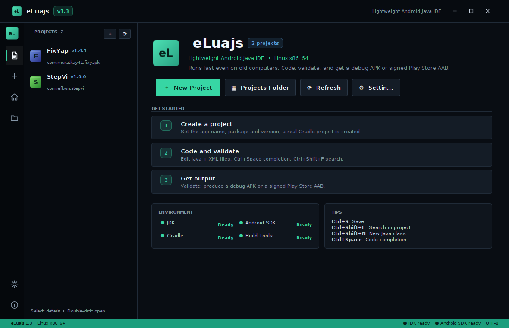
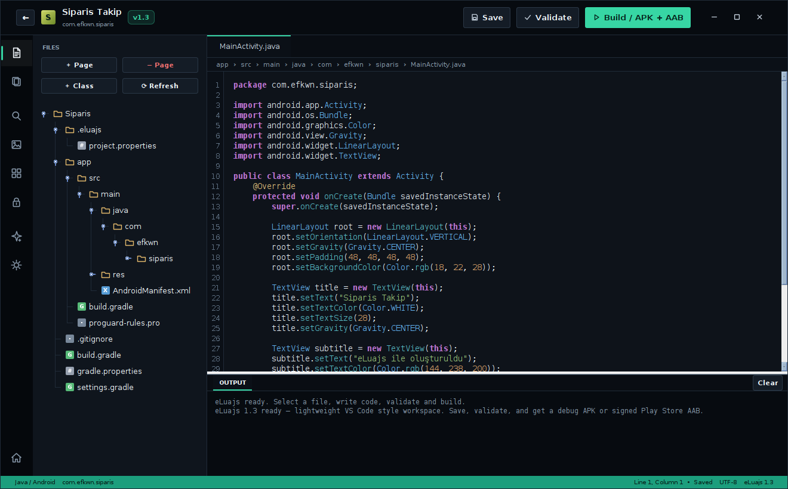
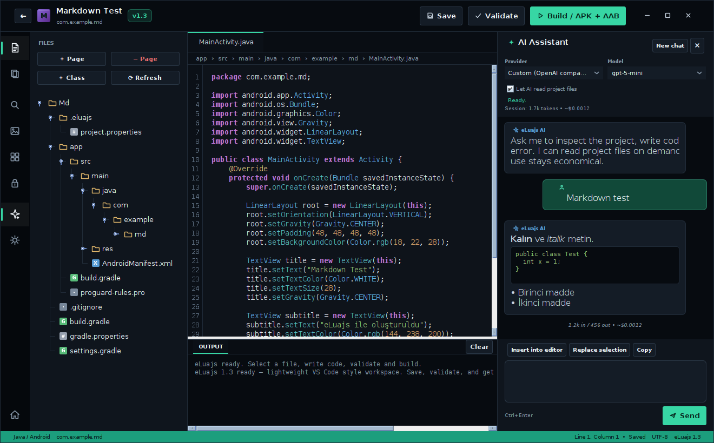

<p align="center">
  
</p>

<h1 align="center">eLuajs</h1>

<p align="center">
  <b>A lightweight Android Java IDE for Linux — built for old computers.</b><br>
  Create real Android Gradle projects, write Java + XML, validate, and export a debug APK or a signed Play Store AAB.
</p>

<p align="center">
  
  
  
  
</p>

---

## Features

- **Lightweight by design** — no Electron, no bundled browser; a compact Java/Swing IDE that stays fast on old machines.
- **Real Android projects** — Java + AndroidX, Gradle, `AndroidManifest.xml`, resources and standard project structure.
- **VS Code-style shell** — activity bar, explorer sidebar, editor tabs, output panel, custom window controls and a dark theme.
- **Editor built for coding** — syntax highlighting, line numbers, `Ctrl+Space` completion, `Ctrl+Shift+F` project search, automatic imports.
- **One-click output** — validate the project and build a debug APK or a signed Play Store **AAB** with an upload keystore.
- **AI coding assistant** — docked chat panel, on-demand project reading, Markdown/code rendering, token usage and approximate cost.
- **Providers** — OpenAI, Claude (Anthropic), Google Gemini, Groq, DeepSeek, OpenRouter, River AI and any OpenAI-compatible endpoint.
- **English by default** — Turkish is available in Settings.
- **Auto-update** — checks GitHub Releases on startup and can replace `app/eLuajs.jar` and restart.

## Screenshots

| Hub | Editor |
| --- | --- |
|  |  |

| AI assistant |  |
| --- | --- |
|  |  |

## Download

Grab the latest release from the [Releases](https://github.com/whyefkan/eLuajs/releases) page:

- **`eLuajs-linux-x86_64.zip`** — portable package with its own Java runtime. Extract and run `./eLuajs`.
- **`eLuajs.jar`** — application jar if you already have Java 17+.

The portable package contains its own runtime, so no system Java installation is required.

## Build from source

Requirements: **JDK 17+** (or the bundled `runtime/bin/javac`).

```bash
cd source
./build.sh
# output: source/out/eLuajs.jar
```

To create the portable package locally:

```bash
source/packaging/build_runtime.sh runtime
gcc -O2 -s -o eLuajs source/packaging/launcher.c
mkdir -p dist/eLuajs/app
cp eLuajs dist/eLuajs/
cp source/out/eLuajs.jar dist/eLuajs/app/
cp -r runtime dist/eLuajs/runtime
```

## AI assistant

Open the AI panel with the activity bar icon or `Ctrl+Alt+A`.

- API keys are stored locally in `~/.eluajs/ai.properties` with `600` permissions.
- The AI receives the project file tree and requests only the files it needs with a `READ: path` protocol — economical on tokens.
- Token usage and approximate cost are shown per response and for the session.
- Generated code can be inserted at the cursor or used to replace the current selection.

## Updates

- Updates are always fetched from the official repository: **`whyefkan/eLuajs`**.
- Auto-check runs on startup and can be disabled in **Settings → Updates**.
- Releases must include an `eLuajs.jar` asset. The included GitHub Actions workflow builds the jar and portable zip when a `v*` tag is pushed.
- The updater backs up the old jar as `eLuajs.jar.bak` before installing.

## License

Apache License 2.0 — see [LICENSE](LICENSE).

---

Made by [whyefkan](https://github.com/whyefkan) / Efkwn Mobile.
